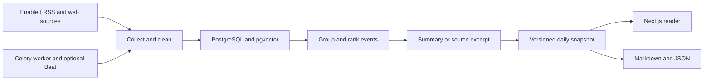

# Architecture

NewsMan separates collection, event grouping, summarization and publication into versioned daily runs.

| Location | Responsibility |
|---|---|
| `backend/newsman/agents/graph.py` | Daily pipeline |
| `backend/newsman/services/collector.py` | Source checks and collection |
| `backend/newsman/services/dedupe.py` | Related-event grouping |
| `backend/newsman/services/summarizer.py` | Bilingual summaries, excerpts and quality state |
| `backend/newsman/services/runs.py` | Run lifecycle and recovery |
| `backend/newsman/services/revisions.py` | Immutable exports and selected reading revision |
| `frontend/components/` | Reader, source controls and review panels |
| `backend/tests/`, `frontend/tests/` | Offline contracts and regressions |

The application keeps source reports distinct from reviewed evidence. A model summary does not become an independently verified fact. A missing body or translation stays visible as missing or degraded.

Compose starts a one-shot schema/registry initializer before the API and worker. API and worker share the digest volume. Browser requests use the host API address; server rendering uses the service address inside the container network.
